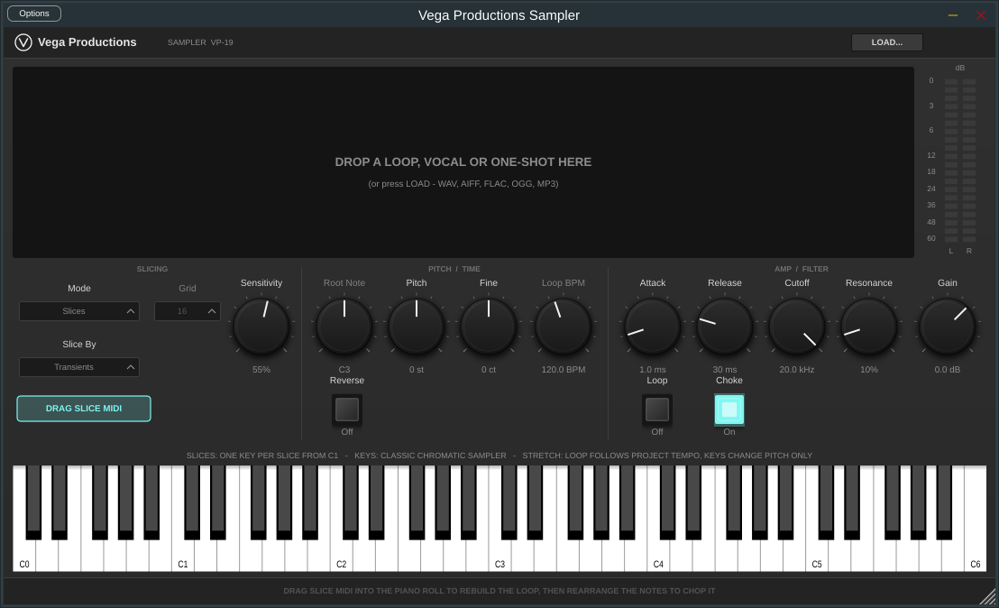

# Vega Productions Sampler (VP-19)

Drop in a loop or vocal: chop it across your keyboard, play it chromatically, or lock it to your project tempo.



## Download
- **Windows (FL Studio):** https://github.com/DJVega70/vega-sampler/releases/latest/download/VegaProductions-Sampler-Windows-VST3.zip
- **macOS:** https://github.com/DJVega70/vega-sampler/releases/latest/download/VegaProductions-Sampler-macOS-VST3-AU.zip

## Modes
- **Slices** — the sample is chopped at its transients (adjustable Sensitivity) or into an even 4/8/16/32 grid. Slice 1 is on C1, slice 2 on C#1 and so on. Click a slice to hear it. **Choke** makes each new hit cut the last one (classic chopping). **DRAG SLICE MIDI** drops the notes into FL Studio's piano roll in the original rhythm — rearrange them to make a new groove.
- **Keys** — a classic sampler: the sample plays chromatically from the Root Note (vocals, stabs, one-shots).
- **Stretch** — the loop follows your project tempo (Loop BPM is detected automatically); keys transpose the pitch without changing the timing.

## Controls
Pitch (±24 st) and Fine, Reverse, Loop, Attack / Release, resonant low-pass Cutoff, Gain. Drag-and-drop files onto the waveform (WAV, AIFF, FLAC, OGG, MP3). The sample path and slice points are saved with your project.

## Building
```
cmake -B build -DVEGA_TESTS=ON
cmake --build build --config Release --target VegaSampler_VST3 VegaSamplerTest
```
